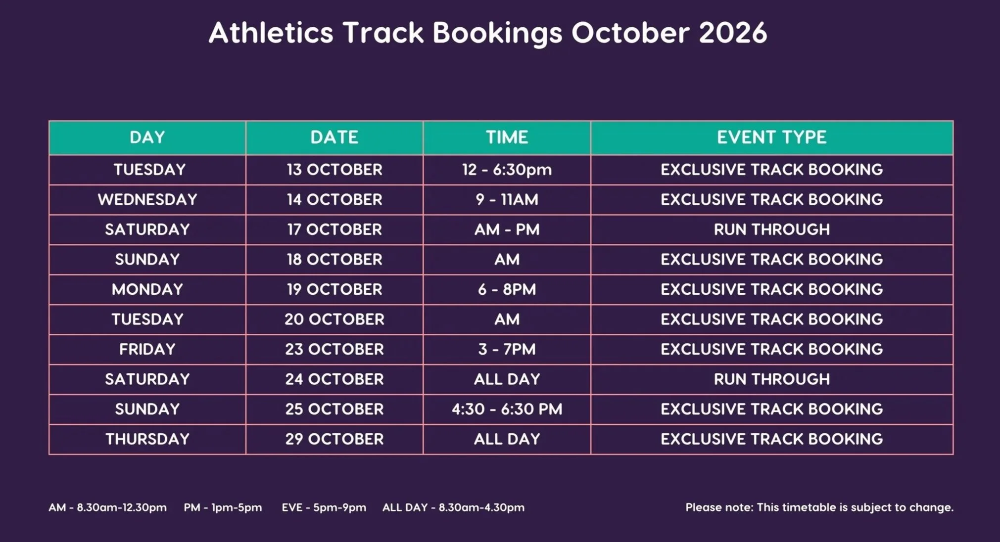

# BPMA track bookings

Copies the athletics track bookings for Battersea Park Millennium Arena into a Google Calendar.

The bookings are only published as images on the [Enable Leisure page](https://www.enableleisure.co.uk/battersea-park-millennium-arena-gym).
A GitHub Actions workflow checks the page three times a day, reads any new sheet with Gemini, and updates the calendar.

## Example

The October 2026 sheet:



Gemini reads each row, using the key at the bottom of the sheet to turn codes like `AM - PM` into times:

```json
{"first_day": "2026-10-13", "time_as_printed": "12 - 6:30PM", "slots": [{"start": "12:00", "end": "18:30"}], "event_type": "EXCLUSIVE TRACK BOOKING"}
{"first_day": "2026-10-17", "time_as_printed": "AM - PM",     "slots": [{"start": "08:30", "end": "17:00"}], "event_type": "RUN THROUGH"}
{"first_day": "2026-10-18", "time_as_printed": "AM",          "slots": [{"start": "08:30", "end": "12:30"}], "event_type": "EXCLUSIVE TRACK BOOKING"}
```

Each row becomes a calendar event per day and time slot:

| Date | Time | Event |
|---|---|---|
| Tue 13 Oct | 12:00–18:30 | Exclusive track booking |
| Sat 17 Oct | 08:30–17:00 | Run through |
| Sun 18 Oct | 08:30–12:30 | Exclusive track booking |

## How it works

1. **Find the sheets** on the page, each identified by the Squarespace asset id in its URL.
2. **Read new sheets** once, with a [Pydantic AI](https://ai.pydantic.dev) agent (`src/bpma/extract.py`). If a
   reading looks wrong, such as a date on the wrong weekday, the model is asked to double-check it once.
3. **Rebuild the future.** When the sheets on the page change, every future event is deleted and recreated from
   them. The past is never touched. The calendar belongs to this app, so don't add events to it by hand.
4. **Commit** what happened to `data/`:

```
data/sheets/<asset_id>/   image.jpg, source.json (where and when it was found), extraction.json (what was read)
                          expected.json (a hand-checked reading, for the evals)
data/runs/<time>.json     each rebuild: the events deleted and created
```

When a new sheet appears, the calendar changes, or the model had to read a sheet twice, the workflow comments on
its `data/` commit and @mentions you, so you get a GitHub notification with the details.

Only one sync runs at a time, and only the schedule or the repo owner can start one. If a sync fails, GitHub
emails you and the next run starts again cleanly. If the page has no sheets at all, the sync fails rather than
emptying the calendar. A keepalive job stops GitHub disabling the schedule during quiet months.

## Commands

Put `GOOGLE_API_KEY`, `GOOGLE_SERVICE_ACCOUNT_JSON` and `CALENDAR_ID` in `.env` (gitignored).
`gh secret set -f .env` copies them to the GitHub secrets the workflow uses.

```bash
make check          # format check, lint, type check, tests
make format         # format and fix lint
make sync-dry-run   # show what the sync would change in the calendar
make sync           # change it
make eval           # score the model against the hand-checked sheets
make report         # open the eval results
```

To rebuild future events even when the sheets haven't changed, run `uv run --env-file .env bpma sync --force`,
or tick "force" when running the workflow from the Actions tab.

## Evals

`make eval MODELS="google:gemini-3.8-flash google:gemini-3.5-flash"` reads each hand-checked sheet three times
per model and saves the results to `evals/results/`. `make report` shows a summary, then a diff from the expected
rows for every reading that wasn't perfect. A run costs about 50p per model and needs a paid Gemini key.

To add a case, put an `image.jpg`, `source.json` and checked `expected.json` in `data/sheets/<asset_id>/`.
